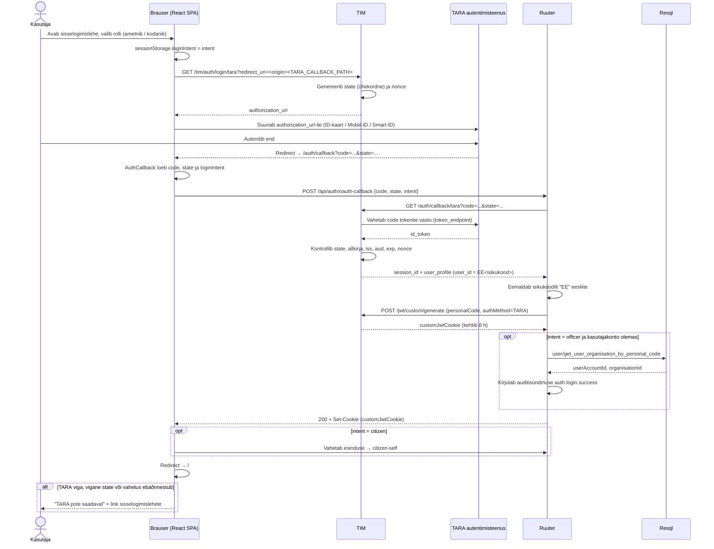
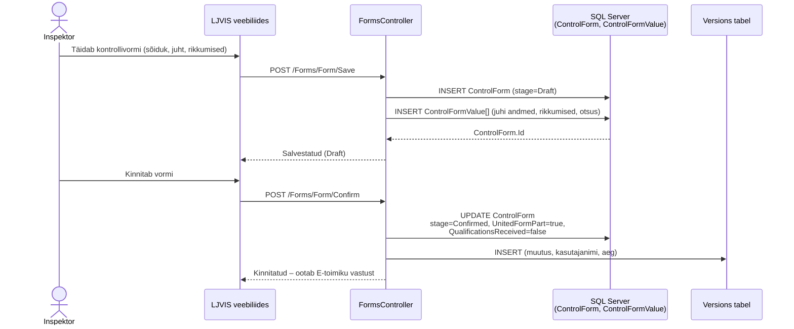
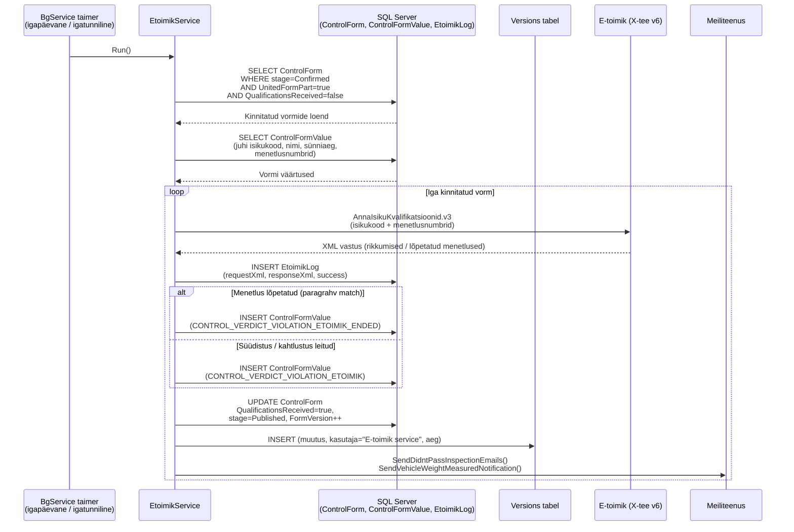
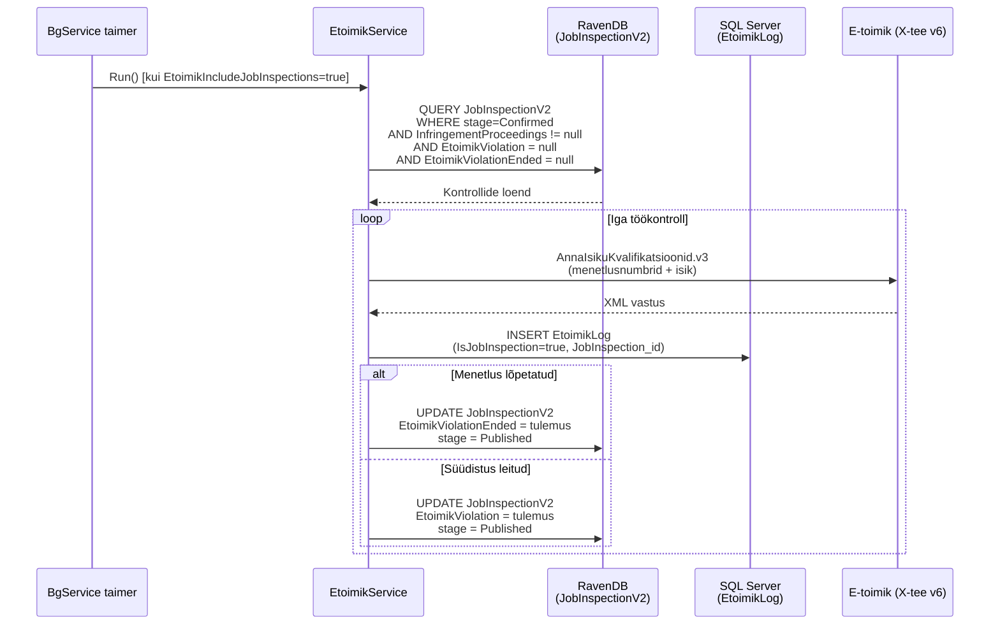
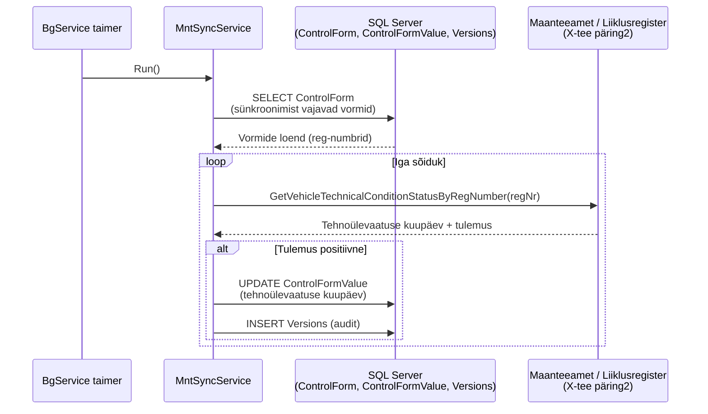
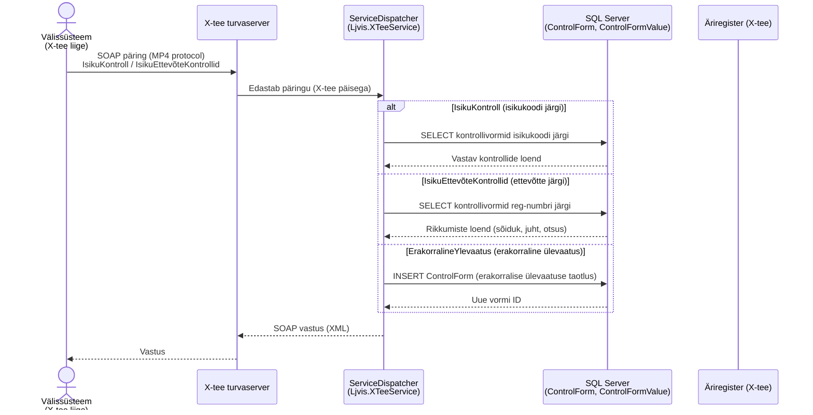

# LJVIS1 – Andmevoogude sequence diagrammid

## 1. Kasutaja autentimine (TARA)



> Callback-teed `/auth/callback` ja `/auth/tara-callback` töötavad mõlemad (frontend [App.tsx](../frontend/src/App.tsx)); `redirect_uri` tee tuleb keskkonnamuutujast `TARA_CALLBACK_PATH` (`/config.json`), vaikimisi `/auth/callback`. Kasutatav väärtus peab olema TIM-i `allowed_redirect_uris` loendis ja registreeritud TARA kliendil.

---

## 2. Kontrollivormi loomine ja kinnitamine (maanteekontroll)



---

## 3. E-toimiku kvalifikatsioonide päring – ControlForm (BgService)



---

## 4. E-toimiku kvalifikatsioonide päring – JobInspection (BgService)



---

## 5. Sõiduki tehnoülevaatuse sünkroonimine (MntSyncService / BgService)



---

## 6. X-tee sissetulev teenus – IsikuKontroll / IsikuEttevõteKontrollid



---

## 7. Avalik päring (kodaniku vaade)

```mermaid
sequenceDiagram
    actor Kodanik
    participant Browser as Brauser (React SPA)
    participant TIM
    participant TARA
    participant Ruuter
    participant Resql as Resql / DB

    Kodanik->>Browser: Avab portaali, valib "Kodanik"
    Browser->>Browser: sessionStorage.loginIntent = citizen
    Browser->>TIM: GET /tim/auth/login/tara?redirect_uri=<origin><TARA_CALLBACK_PATH>
    TIM-->>Browser: authorization_url
    Browser->>TARA: Suunab TARA-sse
    Kodanik->>TARA: Autendib end
    TARA-->>Browser: Redirect → /auth/callback?code=...&state=...

    Browser->>Ruuter: POST /api/auth/oauth-callback {code, state, intent=citizen}
    Ruuter->>TIM: GET /auth/callback/tara (code vahetus, isikukood)
    Ruuter-->>Browser: Set-Cookie (customJwtCookie)
    Note right of Ruuter: DB kasutajakontot ei nõuta;<br/>ametniku auditisündmust ei kirjutata
    Browser->>Ruuter: Esinduse vahetus → citizen-self
    Browser->>Browser: Redirect → / (kodaniku töölaud)

    Kodanik->>Browser: Vaatab oma kontrolliandmeid
    Browser->>Ruuter: GET /api/... (JWT küpsisega)
    Ruuter->>Ruuter: Tuvastab esinduse (citizen-self / company)
    Ruuter->>Resql: Päring isikukoodi järgi
    Resql-->>Ruuter: Kontrolliandmed
    Ruuter-->>Browser: Kontrolliandmete vaade (ainult lugemine)
```
