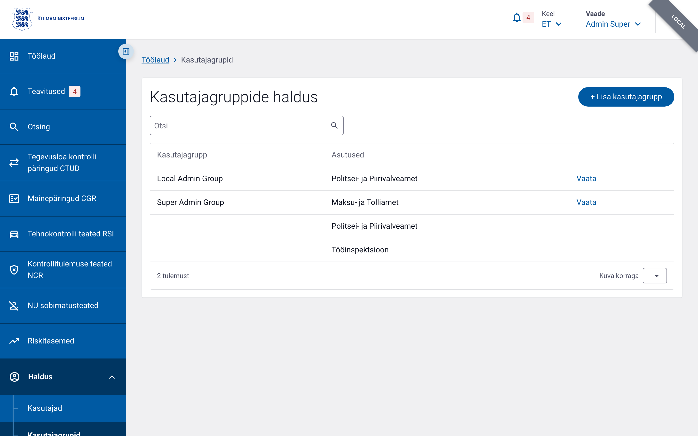
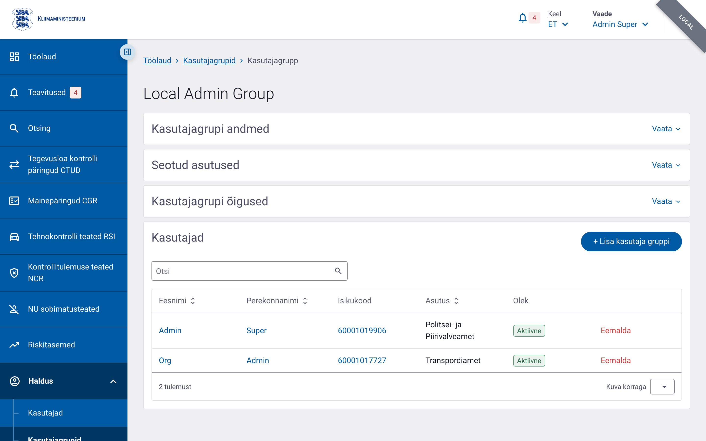

# Kasutajagrupid

Kasutajagrupi kaudu määratakse selle liikmete õigused ja seotud asutused. Üks kasutaja võib kuuluda mitmesse gruppi korraga.

## 1. Vajalikud õigused

Kasutajagruppidega tegelemiseks on vajalikud erinevad õigused sõltuvalt soovitud tegevusest ja ulatusest.

| Tegevus | Vajalik õigus |
|---------|---------------|
| Kasutajagruppide nimekirja vaatamine | `user_group.list.admin` (kõik asutused) või `user_group.list.local` (ainult oma asutus) |
| Ühe grupi detailvaate avamine | `user_group.read.admin` või `user_group.read.local` |
| Uue grupi loomine | `user_group.create` |
| Grupi nime, asutuste või õiguste muutmine | `user_group.update` |
| Kasutajate lisamine gruppi | `control_form.view_unit` | Saab näha oma asutuse ja struktuuriüksuse (PPA puhul prefektuuri) kasutajate loodud vorme nimekirjas, otsingus ja vormi avades. Kasutajal peab olema struktuuriüksus määratud. | „Grupi juht (PPA)" näeb oma prefektuuri alluvate vorme. |
| `control_form.view_organisation` | Saab näha oma asutuse kõigi kasutajate loodud vorme töölaual, otsingus ja vormi avades. | Kontrollide koordinaator. |
| `user_group.add_user` |
| Kasutajate eemaldamine grupist | `user_group.remove_user` |
| Grupi liikmete nimekirja vaatamine | `user_group.list_users.admin` või `user_group.list_users.local` |
| Sobivate kasutajate otsimine gruppi lisamiseks | `user_group.search_eligible_users` |

## 2. Kasutajagruppide nimekiri ja otsing

Kasutajagruppide lehele jõudes kuvatakse kõikide gruppide nimekiri. Vaikimisi on nimekiri sorteeritud grupi nime järgi kasvavas järjekorras (`name asc`).



Otsingulahtris saab sisestada grupi nime või osa sellest. Otsingu käivitamisel laetakse iga leitud grupi kohta ka sellega seotud asutuste nimed, et tulemusi oleks lihtsam üksteisest eristada. Tabelis võidakse sama grupi kohta kuvada mitu rida, kui grupp on seotud mitme asutusega.

Märkus. Kui grupi loomisel on valitud kõiki asutusi hõlmav valik (`coversAllOrganisations`), siis selle grupi puhul asutusi eraldi ei kuvata.

## 3. Uue grupi loomine

Uue grupi loomiseks avage leht **Lisa kasutajagrupp**. Vorm koosneb kolmest osast:

1. **Andmed** — sisestage grupi nimi. Nimi on kohustuslik ja võib olla kuni 50 tähemärki pikk.
2. **Seotud asutused** — valige tabelist asutused, millega grupi seosed luua. Võimalik on valida kõik nähtavad asutused korraga märkeruudu abil või valida asutusi ükshaaval.
3. **Grupi õigused** — valige tabelist õigused, mida grupiliikmetele anda. Nagu asutuste puhul, saab valida kõik õigused korraga või eraldi.

Kui nime või asutusi pole valitud, kuvatakse vastav veateade. Pärast salvestamist suunatakse Teid äsjaloodud grupi detailvaatesse.

## 4. Kasutajate lisamine ja eemaldamine

Grupi detailvaade koondab neli plokki: **Kasutajagrupi andmed**, **Seotud asutused**,
**Kasutajagrupi õigused** ja **Kasutajad**.



### Kasutajate lisamine

Grupi detailvaates avage **Kasutajad** plokk. Kui Teil on õigus `user_group.add_user`, näete nuppu **Lisa kasutaja**. Sellel klõpsates avaneb leht, kus saate otsida ja valida kasutajaid, keda gruppi lisada. Sobivaid kasutajaid otsitakse õiguse `user_group.search_eligible_users` alusel.

Pärast kasutajate lisamist kuvatakse detailvaates kinnitus ja grupi liikmete nimekiri värskendatakse.

### Kasutajate eemaldamine

Grupi liikmete tabelis on iga kasutaja rea lõpus **Eemalda** link, kui Teil on õigus `user_group.remove_user`. Klõpsates seda, kuvatakse kinnitusdialoog. Kinnitamisel eemaldatakse kasutaja kohe grupist. Eemaldamine ei kustuta kasutajakontot, vaid ainult lõpetab grupikuuluvuse.

## 5. Asutuste lisamine ja eemaldamine

Grupi detailvaates avage **Seotud asutused** plokk. Kui Teil on õigus `user_group.update`, saate asutusi muuta:

- Klõpsake **Muuda** või vastavat ikooni.
- Märkige lisatavate asutuste märkeruudud. Tühjendage eemaldatavate asutuste märkeruudud.
- Salvestage muudatused.

Asutuste muutmisel saate valida kõik nähtavad asutused korraga või kombineerida asutusi vabalt. Pärast salvestamist värskendatakse grupi seosed. Kui muudate asutusi, võivad gruppi kuuluvate kasutajate juurdepääsud muutuda.

## 6. Õiguste seadmine

Grupi detailvaates avage **Grupi õigused** plokk. Kui Teil on õigus `user_group.update`, saate õigusi muuta:

- Klõpsake plokis nuppu **Muuda**.
- Märkige lisatavate õiguste märkeruudud. Tühjendage eemaldatavate õiguste märkeruudud.
- Salvestage muudatused.

Õiguste muutmine jõustub kohe. Kõik grupi kasutajad saavad uued õigused, kui nende konto on aktiivne ja asutuslikud piirangud seda võimaldavad. Pärast salvestamist värskendatakse ka kasutaja seansis olevad õigused.

## 7. Levinud õiguste selgitused näidetega

Kasutajagruppide õigused kontrollivad, milliseid andmeid ja tegevusi kasutajad näevad. Siin on levinumate õiguste tähendused ja näited praktilisest kasutusest.

| Õigus | Selgitus | Näide |
|-------|----------|-------|
| `user_group.list.admin` | Saab kõiki kasutajagruppe otsida ja nimekirja vaadata. | Peakasutaja vaatab üle kõikide asutuste grupid. |
| `user_group.list.local` | Saab otsida ja nimekirja vaadata ainult oma asutuse gruppe. | Asutuse administraator vaatab oma asutuse gruppe. |
| `user_group.read.admin` | Saab avada iga grupi detailvaate. | Kõikide gruppide seadete kontrollimine. |
| `user_group.read.local` | Saab avada ainult oma asutusega seotud gruppide detailvaate. | Asutuse administraator kontrollib oma asutusega seotud grupi andmeid. |
| `user_group.create` | Saab luua uusi kasutajagruppe. | Uue rolligrupi loomine, nt „PPA analüütikud“. |
| `user_group.update` | Saab muuta grupi nime, asutusi ja õigusi. | Grupi õiguste häälestamine. |
| `user_group.add_user` | Saab kasutajaid gruppi lisada. | Uue töötaja lisamine analüütikute gruppi. |
| `user_group.remove_user` | Saab eemaldada kasutajaid grupist. | Lahkuva töötaja eemaldamine rolligrupist. |
| `user.list.admin` / `user.list.local` | Saab vaadata kasutajate nimekirja vastavalt ulatusele. | Kasutajate otsimine gruppi lisamiseks. |
| `user.read.admin` / `user.read.local` | Saab vaadata kasutaja andmeid. | Grupi liikme nimel klõpsates avaneb kasutaja detailvaade. |

## 8. Näited päringutena (curl)

Järgmised näited kasutavad sama autentimise mudelit kui muud adminjuhendid: päringutes peab kaasas olema kehtiv TARA/TIM seansiküpsis. Kohatäited:

- `https://<base-url>` — rakenduse baasaadress, nt `https://dev.liiklusvalve.ee`
- `<COOKIE>` — TARA/TIM seansiküpsise väärtus

### Kasutajagruppide otsing

Otsige nime järgi, lehekülg 1, 20 rida lehekülje kohta, kõigi asutuste ulatuses (`admin`):

```bash
curl -X GET "https://<base-url>/v1/user-groups/admin/search?q=analyst&page=1&pageSize=20" \
  -H "Cookie: <COOKIE>"
```

### Kasutajagrupi õiguste muutmine

Muutke grupi õigusi, määrates täieliku õiguste nimekirja. Kõik varem seotud õigused, mida siin ei ole, eemaldatakse:

```bash
curl -X PUT "https://<base-url>/v1/user-groups/permissions" \
  -H "Cookie: <COOKIE>" \
  -H "Content-Type: application/json" \
  -d '{
    "id": 12,
    "permissionIds": [3, 7, 15]
  }'
```

API lõpp-punkti `PUT /v1/user-groups/permissions` puhul kasutatakse õiguste unikaalseid ID-sid (`permissionIds`), mitte koodinimesid. Grupi loomisel saate õigused määrata koodide järgi järgmise `POST /v1/user-groups` päringuga:

```bash
curl -X POST "https://<base-url>/v1/user-groups" \
  -H "Cookie: <COOKIE>" \
  -H "Content-Type: application/json" \
  -d '{
    "name": "PPA analüütik",
    "organisationIds": [7],
    "permissionCodes": ["user.list.local", "user.read.local"]
  }'
```
