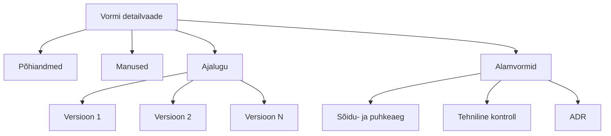
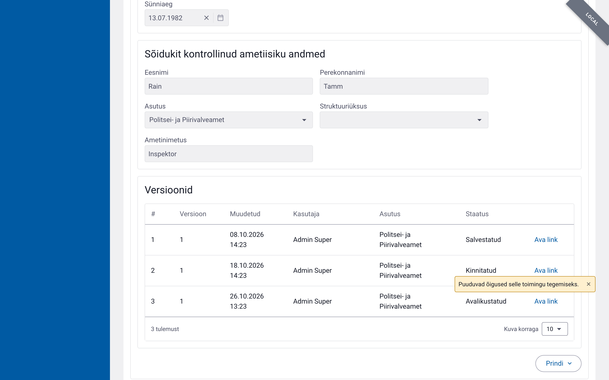
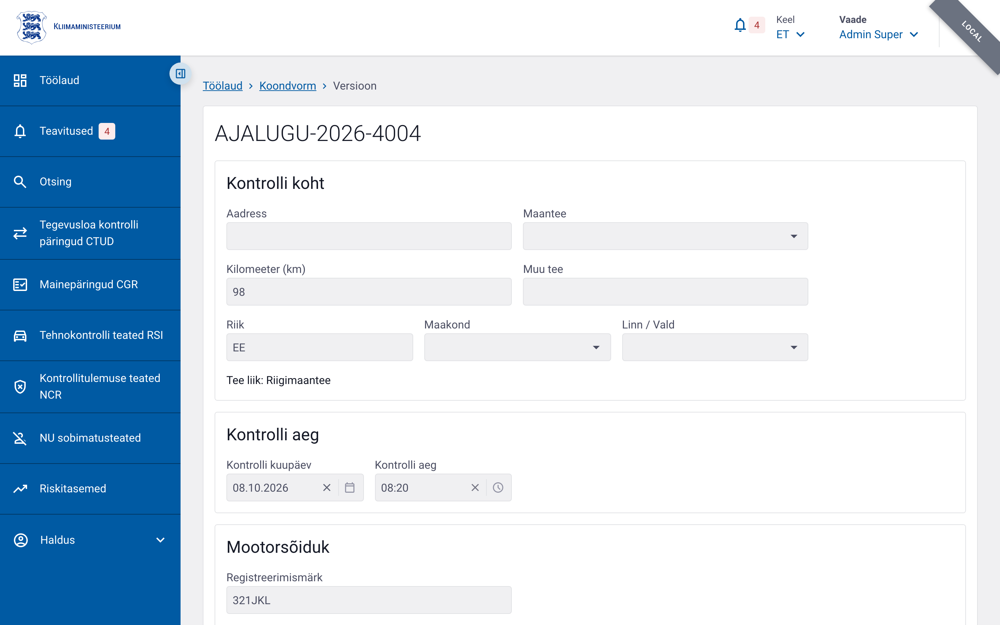

# Vormide vaatamine ja ajalugu

Salvestatud vormidele pääseb ligi nimekirja, töölaua või otsingu kaudu.

## Vormi detailvaade

Vormi detailvaade koosneb järgmistest osadest:

- **Põhiandmed** — vormi kõik täidetud väljad kaartide kaupa
- **Manused** — üleslaaditud failid
- **Ajalugu** — varasemad salvestatud versioonid
- **Alamvormid** — koondvormi puhul seotud alamvormid

## URL-i struktuur

| Vaade | URL |
|---|---|
| Põhivaade | `/control-forms/<tüüp>/<id>` |
| Ajalooline versioon | `/control-forms/<tüüp>/<id>/<snapshotId>` |

Näide:
- `/control-forms/foreign-violation/12345`
- `/control-forms/foreign-violation/12345/snapshot-67890`

Vormi vaate lõpus on **Versioonid** tabel, kus on iga salvestatud versioon koos
staatuse, muutja ja kuupäevaga. Lingiga **Ava link** avaneb vastav ajalooline versioon.

## Ajalooline versioon

Ajalooline versioon sisaldab vormi andmeid kindlal ajahetkel. Uue versiooni tekkimise reeglid sõltuvad vormitüübist. Varasemate versioonide abil saab:

- vaadata, kuidas vorm aja jooksul muutus
- võrrelda kahte versiooni
- tõendada, milline oli vormi seisund kindlal ajal

Ajaloolises versioonis on kõik väljad kirjutuskaitstud:

## Muudatuste võrdlus

Mõned vormid võimaldavad võrrelda kahte versiooni. Süsteem kuvab:

- millised väljad on muutunud
- vana ja uue väärtuse
- muutmise kuupäeva
- muutja nime

## Vormi staatused

| Staatus | Selgitus |
|---|---|
| Salvestatud | Vorm on salvestatud ja seda saab muuta. |
| Kinnitatud | Vorm on kinnitatud. Muutmisvõimalus sõltub vormitüübist ja kasutaja õigustest. |
| Avalikustatud | Vorm on avalikustatud. Muutmisvõimalus sõltub vormitüübist ja kasutaja õigustest. |
